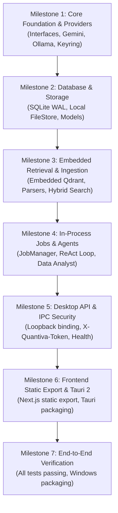

# QUANTIVA DESKTOP MIGRATION PLAN
## Architecture Blueprint & Implementation Specification

> **Migration Baseline Reference**:
> - **Git Baseline Commit**: `134dc4ad168d4a332874bc959307c63dcb76e752`
> - **Git Baseline Tag**: `pre-desktop-migration-baseline`
> - **Verification Baseline**: 149 passed, 1 skipped (`pytest`), Frontend build & lint 100% clean.
> - **Core Objective**: Migrate Quantiva from a 10-container cloud topology (PostgreSQL, Redis, Celery, Qdrant, S3/MinIO, Prometheus, Grafana) to a zero-external-dependency, local-first Windows 10/11 desktop application powered by **Tauri 2 + Next.js (Static Export) + Packaged FastAPI + SQLite (WAL/FTS5) + Embedded Qdrant/LanceDB**.

---

## 1. Current vs. Target Architecture Mapping Table

Every file currently in `backend/app/` is accounted for and mapped to its target module in the desktop architecture:

| Current File Path | Target Architecture Module | Desktop Migration Disposition & Notes |
|---|---|---|
| `app/config.py` | `app/core/config.py` | Refactor to desktop configuration: introduce `QUANTIVA_DATA_DIR` (`%LOCALAPPDATA%/Quantiva` default), remove mandatory Redis/S3/Postgres URLs, bind host `127.0.0.1`. |
| `app/main.py` | `app/main.py` | Simplify lifespan: initialize `ApplicationContext` singleton (SQLite engine, local FileStore, embedded Qdrant, JobManager). Update `/health` & `/ready` for local drivers. |
| `app/api/v1/auth.py` | `app/api/v1/auth.py` | Adapt for desktop: provide auto-login / seed resolution for `DEFAULT_LOCAL_USER_ID`, simplify session tracking in SQLite, bypass password enforcement for local desktop mode. |
| `app/api/v1/charts.py` | `app/api/v1/charts.py` | Serve charts directly from local disk via `FileResponse` instead of S3 presigned 307 redirects. |
| `app/api/v1/chat.py` | `app/api/v1/chat.py` | Preserve SSE streaming turn logic; route LLM completions through `LLMProvider` interface; persist chat turns and citations in SQLite. |
| `app/api/v1/documents.py` | `app/api/v1/documents.py` | Replace `process_document.delay()` with local `JobManager.submit_ingestion()`; store uploads via local `FileStore`. |
| `app/api/v1/eval.py` | `app/api/v1/eval.py` | Replace Celery task submission with local `JobManager.submit_eval()`; fetch results from SQLite. |
| `app/api/v1/metrics_endpoint.py` | `app/api/v1/metrics.py` | Keep as optional in-memory diagnostic metric endpoint or local inspection tool. |
| `app/api/v1/retrieval.py` | `app/api/v1/retrieval.py` | Retain `/api/v1/retrieval/search` endpoint contract; query through refactored `HybridRetriever`. |
| `app/core/dependencies.py` | `app/core/dependencies.py` | Support `X-Quantiva-Token` desktop IPC header from Tauri; auto-resolve `DEFAULT_LOCAL_USER` without requiring login cookie. |
| `app/core/metrics.py` | `app/core/metrics.py` | Keep lightweight Prometheus metric counters in-process without requiring external Prometheus daemon. |
| `app/core/middleware.py` | `app/core/middleware.py` | Enforce loopback check (`127.0.0.1` only) and `X-Quantiva-Token` header verification for all non-health routes. |
| `app/core/ownership.py` | `app/core/ownership.py` | **Preserved intact**: continues asserting `user_id` matches `DEFAULT_LOCAL_USER_ID` or multi-tenant user. |
| `app/core/rate_limiter.py` | `app/core/rate_limiter.py` | Replace Redis Lua script with an in-memory thread-safe sliding window rate limiter (or bypass in desktop mode). |
| `app/core/security.py` | `app/security/tokens.py` & `app/security/credentials.py` | Keep JWT utility functions; add Windows Credential Manager integration via `keyring` for secure cloud API key storage. |
| `app/core/storage.py` | `app/storage/filestore.py` | Complete replacement: replace `boto3`/S3 with `LocalFileStore` managing files under `%LOCALAPPDATA%/Quantiva/documents/` and `/charts/`. |
| `app/db/database.py` | `app/db/database.py` | Replace `postgresql+asyncpg` with `sqlite+aiosqlite` configured with `WAL`, `busy_timeout=10000`, and `foreign_keys=ON`. |
| `app/db/session.py` | `app/db/session.py` | Async sessionmaker for SQLite. |
| `app/db/migrations/*` | `app/db/migrations/` (or `init_db.py`) | Replace PostgreSQL DDL migrations with desktop SQLite initial schema generation and migration scripts. |
| `app/models/user.py` | `app/models/user.py` | Change PostgreSQL `UUID` to SQLite-compatible `UUID(as_uuid=True)` with string compilation; support pre-seeded local user. |
| `app/models/auth_session.py` | `app/models/auth_session.py` | SQLite compatible session tracking. |
| `app/models/document.py` | `app/models/document.py` | Replace `JSONB` with `JSON`; store relative local filesystem paths in `storage_path`. |
| `app/models/chunk.py` | `app/models/chunk.py` | Store chunk text, chunk index, page number, and vector store ID. |
| `app/models/session.py` | `app/models/session.py` | Replace `ARRAY` with `JSON` column for `document_ids`. |
| `app/models/message.py` | `app/models/message.py` | Replace `JSONB` with `JSON` for `citations` and `guardrail_flags`. |
| `app/models/eval_result.py` | `app/models/eval_result.py` | Replace `JSONB` with `JSON` for `per_question_scores`. |
| `app/schemas/*` | `app/schemas/*` | **Preserved intact**: all Pydantic request and response schemas remain identical. |
| `app/services/agents/base_agent.py` | `app/agents/base_agent.py` | Decouple from `google.genai`: convert prompt formatting and tool schema calls to `LLMProvider` interface. |
| `app/services/agents/orchestrator.py` | `app/agents/orchestrator.py` | **Preserved intact**: query routing between Data Analyst and Reasoning Agent. |
| `app/services/agents/reasoning_agent.py` | `app/agents/reasoning_agent.py` | **Preserved intact**: ReAct loop, tool registry execution, structured answer synthesis, and citation mapping. |
| `app/services/eval/*` | `app/evaluation/*` | Decouple judge and dataset generator from `gemini_client` to `LLMProvider` interface; preserve scoring algorithms. |
| `app/services/guardrails/*` | `app/security/guardrails/*` | **Preserved intact**: PII regex/Presidio masking, Hallucination sentence check, and ContentFilter. |
| `app/services/ingestion/chunker.py` | `app/ingestion/chunker.py` | **Preserved intact**: recursive text splitter, token chunk sizing, and chunk metadata. |
| `app/services/ingestion/ingestion_service.py` | `app/ingestion/ingestion_service.py` | **Preserved intact**: parser dispatch, chunking, embedding generation, vector upsert, and DB recording. |
| `app/services/ingestion/status_monitor.py` | `app/ingestion/status_monitor.py` | Adapt watchdog to check local `JobManager` task state instead of Celery broker ping. |
| `app/services/ingestion/upload_validation.py` | `app/ingestion/upload_validation.py` | **Preserved intact**: magic byte checking, extension checks, and file size limits. |
| `app/services/ingestion/parsers/*` | `app/ingestion/parsers/*` | **Preserved intact**: PDF (PyMuPDF), DOCX (python-docx), Excel (openpyxl/pandas), CSV (csv/pandas). |
| `app/services/llm/gemini_client.py` | `app/providers/gemini/gemini_llm.py` | Extract as concrete implementation of `LLMProvider` interface under `app/providers/gemini/`. |
| `app/services/llm/context_manager.py` | `app/core/context_manager.py` | **Preserved intact**: budget-based token context allocation. |
| `app/services/llm/output_parser.py` | `app/core/output_parser.py` | **Preserved intact**: structured JSON repair and extraction. |
| `app/services/llm/prompt_builder.py` | `app/core/prompt_builder.py` | **Preserved intact**: prompt templates and system instructions. |
| `app/services/memory/memory_pager.py` | `app/core/memory_pager.py` | Decouple summarization prompt call to `LLMProvider`. |
| `app/services/memory/semantic_cache.py` | `app/retrieval/semantic_cache.py` | Replace Redis key-value with local SQLite or in-process cache; decouple from hardcoded Gemini config. |
| `app/services/memory/session_memory.py` | `app/db/session_memory.py` | Replace Redis list with direct SQLite query against `messages` table. |
| `app/services/retrieval/bm25_retriever.py` | `app/retrieval/bm25_retriever.py` | **Preserved intact**: rank-bm25 in-memory indexing, with option for SQLite FTS5 acceleration. |
| `app/services/retrieval/embedding_service.py` | `app/providers/gemini/gemini_embedding.py` | Extract as `EmbeddingProvider` implementation; create provider interfaces for Ollama/local embeddings. |
| `app/services/retrieval/hybrid_retriever.py` | `app/retrieval/hybrid_retriever.py` | **Preserved intact**: RRF fusion algorithm ($1 / (k + rank)$) combining dense vector search and BM25 search. |
| `app/services/retrieval/reranker.py` | `app/providers/local/minilm_reranker.py` | Wrap existing `sentence_transformers.CrossEncoder` behind `RerankerProvider` interface. |
| `app/services/retrieval/vector_store.py` | `app/retrieval/vector_store.py` | Replace external Qdrant HTTP client with embedded `QdrantClient(path=...)` or LanceDB via singleton context. |
| `app/services/tools/chart_generator.py` | `app/agents/tools/chart_generator.py` | Save PNG charts directly to local storage directory; return relative `/api/v1/charts/...` URL. |
| `app/services/tools/python_executor.py` | `app/agents/tools/python_executor.py` | **Preserved intact**: restricted Python execution for data analyst queries. |
| `app/services/tools/python_sandbox.py` | `app/agents/tools/python_sandbox.py` | **Preserved intact**: AST validation and disallowed import blocking. |
| `app/services/tools/registry.py` | `app/agents/tools/registry.py` | **Preserved intact**: tool registration and JSON schema generation. |
| `app/workers/celery_app.py` | *Deleted* | Replaced by `app/jobs/job_manager.py`. |
| `app/workers/ingestion_worker.py` | `app/jobs/ingestion_job.py` | Executed directly in background thread via `JobManager` with status recorded in SQLite. |
| `app/workers/eval_worker.py` | `app/jobs/eval_job.py` | Executed directly in background thread via `JobManager` with status recorded in SQLite. |

---

## 2. Preservation Matrix ("Do Not Break")

Under Rule 1 (*Do Not Rewrite From Scratch*), the core intelligence and domain logic of Quantiva must remain identical before and after migration. The table below outlines what will be strictly preserved:

```
┌────────────────────────────────────────────────────────────────────────┐
│                   PRESERVED DOMAIN INTELLIGENCE                       │
│                                                                        │
│   ┌─────────────────────┐    ┌─────────────────────┐                  │
│   │ Document Parsers    │    │ Chunker             │                  │
│   │ • PDF (PyMuPDF)     │───>│ • Recursive splitter│                  │
│   │ • DOCX / Excel / CSV│    │ • 500-token chunks  │                  │
│   └─────────────────────┘    └─────────────────────┘                  │
│                                         │                              │
│                                         ▼                              │
│   ┌─────────────────────┐    ┌─────────────────────┐                  │
│   │ RRF Fusion & Search │    │ ReAct Reasoning     │                  │
│   │ • RRF 1/(k + rank)  │<───│ • BaseAgent loop    │                  │
│   │ • BM25 + CrossEnc   │    │ • Data Analyst sandbox│                 │
│   └─────────────────────┘    └─────────────────────┘                  │
│                                         │                              │
│                                         ▼                              │
│   ┌─────────────────────┐    ┌─────────────────────┐                  │
│   │ Guardrails & Safety │    │ Citation Pipeline   │                  │
│   │ • PII Detection     │    │ • Chunk highlights  │                  │
│   │ • Hallucination Chk │    │ • Token audit       │                  │
│   └─────────────────────┘    └─────────────────────┘                  │
└────────────────────────────────────────────────────────────────────────┘
```

| Component | Source File | Critical Invariants to Preserve |
|---|---|---|
| **Document Parsers** | `app/services/ingestion/parsers/` (`pdf_parser.py`, `docx_parser.py`, `excel_parser.py`, `csv_parser.py`) | Page-number extraction, table-structure parsing, text cleaning, and fallback handlers. |
| **Chunking Logic** | `app/services/ingestion/chunker.py` | 500-token chunk sizing, overlap boundaries, structural metadata (`page`, `chunk_type`, `row_index`). |
| **Hybrid Search & Fusion** | `app/services/retrieval/hybrid_retriever.py` | Reciprocal Rank Fusion ($k=60$), top-20 dense + top-20 sparse merge, top-30 candidates fed to cross-encoder reranker, top-8 final output. |
| **Cross-Encoder Reranking** | `app/services/retrieval/reranker.py` | `cross-encoder/ms-marco-MiniLM-L-6-v2` lazy loading, thread lock serialization, prediction sorting. |
| **ReAct Reasoning Loop** | `app/services/agents/reasoning_agent.py` & `base_agent.py` | Multi-step tool invocation loop (up to 10 iterations), retrieval cache, repeat filter, structured JSON parsing with repair retry. |
| **Data Analyst Agent** | `app/services/agents/reasoning_agent.py` | Python code generation, matplotlib chart generation, execution result validation. |
| **Python Sandbox** | `app/services/tools/python_sandbox.py` & `python_executor.py` | AST parsing, restricted execution scope, prohibition of OS and filesystem access. |
| **Citation System** | `app/schemas/agent.py` (`Citation`, `AgentAnswer`) | Granular page references, text snippets, chunk IDs, source document verification. |
| **Guardrails & Filters** | `app/services/guardrails/` | Regex patterns for SSN/email/phone/card, sentence-level hallucination cosine verification against retrieved context. |

---

## 3. Cloud-to-Local Replacement Specifications

### 3.1 Relational Database: PostgreSQL $\rightarrow$ SQLite (WAL + FTS5)
- **Engine**: `create_async_engine("sqlite+aiosqlite:///<DATA_DIR>/quantiva.db")`.
- **Concurrency & Pragma Configuration**:
  ```python
  @event.listens_for(engine.sync_engine, "connect")
  def set_sqlite_pragma(dbapi_connection, connection_record):
      cursor = dbapi_connection.cursor()
      cursor.execute("PRAGMA journal_mode=WAL")
      cursor.execute("PRAGMA synchronous=NORMAL")
      cursor.execute("PRAGMA busy_timeout=10000")
      cursor.execute("PRAGMA foreign_keys=ON")
      cursor.close()
  ```
- **Type Compatibility**:
  - `UUID(as_uuid=True)`: mapped to `TEXT` (length 36) in SQLite.
  - `JSONB` / `ARRAY`: mapped to SQLite native `JSON` with JSON1 extension support.
- **Full-Text Search (FTS5)**:
  - Create SQLite virtual table `chunks_fts USING fts5(chunk_id UNINDEXED, doc_id UNINDEXED, text)` for indexed BM25 search without needing memory re-indexing.

### 3.2 Storage: S3 / MinIO $\rightarrow$ Local `FileStore`
- **Location**: `pathlib.Path(settings.QUANTIVA_DATA_DIR) / "storage" / "documents"` and `... / "charts"`.
- **Implementation**:
  - Atomic writes via temporary file and rename (`os.replace`).
  - Strict path traversal prevention: verify all resolved paths start within `storage_dir`.
  - Chart serving: replace presigned S3 URLs with direct FastAPI `FileResponse` from local disk.

### 3.3 Vector Store: External Qdrant $\rightarrow$ Embedded Local Qdrant / LanceDB
- **Engine**: Embedded `QdrantClient(path=str(settings.QUANTIVA_DATA_DIR / "vector_store"))` or `LanceDB`.
- **Singleton Lifecycle Rule (Rule 5)**: Embedded vector stores lock files on disk; the connection **must never** be instantiated per request. It must be created once during application startup in `ApplicationContext` and gracefully closed on shutdown.
- **Model Space Independence (Rule 3)**:
  - Vector collections encode model identity and dimensions: `f"kb_{kb_id}_{embedding_provider}_{dim}"`.
  - Mismatched query dimensions immediately raise `EmbeddingDimensionMismatchError` before any disk operations.

### 3.4 Queue & Broker: Celery + Redis $\rightarrow$ Local `JobManager`
- **Architecture**:
  ```
  FastAPI Route (upload) ──> SQLite (job: pending) ──> JobManager.queue.put(job_id)
                                                                │
                                                                ▼
                                                     asyncio Worker Task
                                                                │
                                            ┌───────────────────┴───────────────────┐
                                            ▼                                       ▼
                                   Ingestion Pipeline                      Evaluation Pipeline
                                            │                                       │
                                            └───────────────────┬───────────────────┘
                                                                ▼
                                                     SQLite (job: completed)
  ```
- **Job Persistence**: SQLite table `processing_jobs(id, type, payload_json, status, error, created_at, updated_at)`.
- **Crash Recovery**: On application boot, any jobs in `processing` or `pending` status are inspected; orphaned tasks are automatically marked failed or requeued cleanly.

### 3.5 Authentication & Multi-Tenancy: Cloud JWT $\rightarrow$ Local Profile & IPC Token
- **Default Profile**: A pre-seeded record `DEFAULT_LOCAL_USER_ID = "00000000-0000-0000-0000-000000000001"` in SQLite satisfies foreign key constraints across documents, sessions, and messages.
- **IPC Security**: The Tauri shell generates a secure random token at startup and passes it to the Python backend process. Every HTTP request from the frontend webview includes header `X-Quantiva-Token: <token>`. Requests without this header (or from origins other than loopback) are rejected with HTTP 403.
- **Provider API Keys**: Cloud API keys (Gemini, OpenAI, Anthropic) are stored via `keyring` in Windows Credential Manager, with AES-256 encrypted file fallback if the credential vault is unavailable.

---

## 4. Frontend Integration Strategy (Tauri 2 + Next.js)

### 4.1 Static Export Audit Findings
| Feature | Current State | Required Change for Tauri Desktop |
|---|---|---|
| **Build Target** | `output: 'standalone'` in `next.config.ts` | Change to `output: 'export'` for bundling into Tauri application assets. |
| **API Proxy** | `async rewrites()` forwarding `/api/v1/*` to `http://localhost:8000` | In static export, Next.js disables `rewrites()`. Update `frontend/src/lib/api.ts` to use configurable `NEXT_PUBLIC_API_URL` (default: `http://127.0.0.1:8000`). |
| **Dynamic Route Segment** | `/chat/[sessionId]/page.tsx` is server-rendered on demand (`ƒ`) | Convert `/chat/[sessionId]` to client-side routing: either use query parameters (`/chat?sessionId=...`), client hash routing, or export a static shell using `generateStaticParams()` returning dummy fallback or catch-all. Query parameter routing (`/chat?sessionId=...`) or `useSearchParams()` provides the cleanest static export compatibility. |
| **Image Optimization** | `<Image src={message.chart_url} ... />` in `MessageBubble.tsx` | Next.js image optimization requires a Node.js server. Configure `images: { unoptimized: true }` in `next.config.ts`. |
| **Authentication Flow** | `/login` and `/register` redirect on 401 | For desktop mode, default directly to `/chat` using the local profile session. |

### 4.2 Exact Frontend Files Requiring Updates
1. `frontend/next.config.ts`: Enable `output: 'export'`, `images: { unoptimized: true }`, remove `rewrites()`.
2. `frontend/src/lib/api.ts`: Set Axios `baseURL` to `http://127.0.0.1:8000/api/v1` and inject `X-Quantiva-Token` header.
3. `frontend/src/app/(dashboard)/chat/[sessionId]/page.tsx` & routing: Adapt dynamic route segment for static export.
4. `frontend/src/app/page.tsx`: Route directly to workspace session without requiring cloud authentication handshake.

---

## 5. Step-by-Step File Migration Order (Dependency Graph)

The migration is sequenced bottom-up so that at each milestone, the test suite (`pytest`) can be executed and verified without breaking existing features:



### Detailed Milestone Tasks

#### Milestone 1: Provider Decoupling & Interfaces
1. Create `app/providers/interfaces/` (`LLMProvider`, `EmbeddingProvider`, `RerankerProvider`).
2. Implement `app/providers/gemini/` (`GeminiLLMProvider`, `GeminiEmbeddingProvider`).
3. Implement `app/providers/ollama/` (`OllamaLLMProvider`, `OllamaEmbeddingProvider`).
4. Implement `app/providers/local/` (`CrossEncoderRerankerProvider`).
5. Implement `app/security/credentials.py` (Windows Credential Manager / `keyring`).
6. **Verification**: Unit tests for all providers and credential handling.

#### Milestone 2: SQLite Persistence & Local File Storage
1. Update `app/core/config.py` with `QUANTIVA_DATA_DIR` and desktop paths.
2. Refactor `app/db/database.py` for SQLite WAL mode and connection pooling.
3. Update SQLAlchemy models in `app/models/` for SQLite JSON/UUID compatibility.
4. Implement `app/storage/filestore.py` with path traversal guards.
5. **Verification**: Run existing database and model tests against SQLite engine.

#### Milestone 3: Embedded Vector Store & Retrieval Pipeline
1. Implement `app/core/application_context.py` managing embedded vector client lifecycle.
2. Refactor `app/retrieval/vector_store.py` to use embedded Qdrant / LanceDB.
3. Validate `app/retrieval/hybrid_retriever.py` and `bm25_retriever.py` with embedded vector results.
4. **Verification**: Run `test_hybrid_retriever.py` and `test_chunker.py`.

#### Milestone 4: Local JobManager & Agent Refactoring
1. Implement `app/jobs/job_manager.py` with SQLite task persistence and crash recovery.
2. Port `ingestion_worker` and `eval_worker` tasks into in-process jobs.
3. Decouple `base_agent.py` and `reasoning_agent.py` from `google.genai` SDK, routing through `LLMProvider`.
4. Decouple `eval_dataset.py` and `llm_judge.py` to use `LLMProvider`.
5. **Verification**: Run ReAct agent integrity tests and ingestion workflow tests.

#### Milestone 5: Desktop API Endpoints & IPC Security
1. Enforce `127.0.0.1` binding and loopback validation in `app/core/middleware.py`.
2. Add `X-Quantiva-Token` header validation to API dependencies.
3. Update `app/api/v1/charts.py` to serve files via `FileResponse`.
4. Update `app/main.py` lifespan and health probes.
5. **Verification**: Full backend integration test suite execution (`pytest`).

#### Milestone 6: Frontend Static Export & Tauri 2 Integration
1. Update `next.config.ts` for `output: 'export'`.
2. Adapt `/chat/[sessionId]` for static export.
3. Update `api.ts` with direct local backend URL and IPC headers.
4. Initialize Tauri 2 project configuration (`src-tauri/`) and build pipeline.
5. **Verification**: `npm run build` static export succeeds with zero errors.

#### Milestone 7: End-to-End Desktop Verification
1. Run complete `pytest` suite across all unit, integration, and E2E tests.
2. Verify document ingestion, hybrid search, ReAct reasoning, code execution, and chart generation in packaged desktop app.
3. Verify zero external network requests occur when using local Ollama model.
