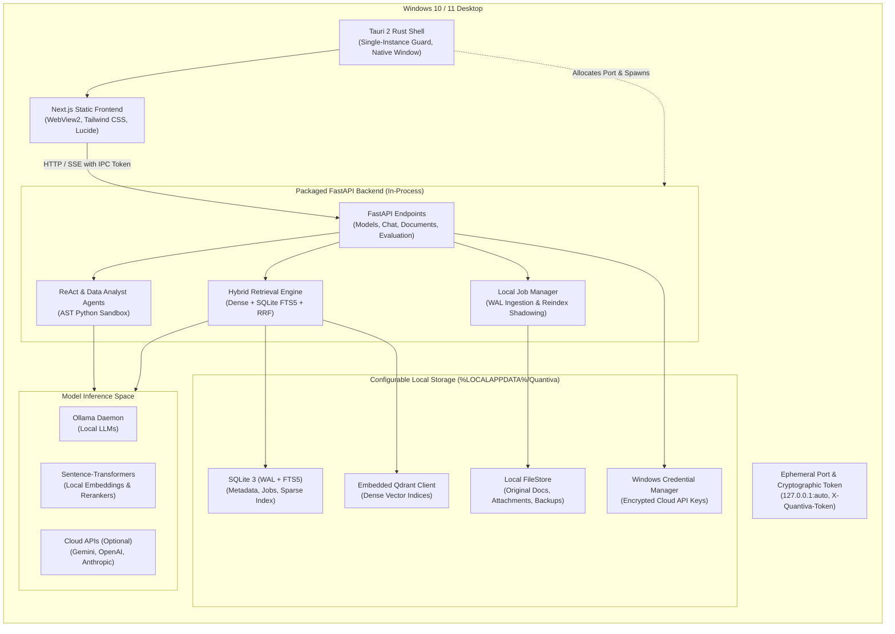

# Quantiva

> Private, Local-First AI Document Intelligence & Agentic RAG for Windows

[](https://github.com/Istiyak-Ishan/Quantiva/actions/workflows/ci.yml)


<!--
TODO: Capture and add desktop screenshots to docs/assets/
- docs/assets/dashboard.png (Overview of Knowledge Bases and Hardware Tier)
- docs/assets/model-studio.png (Independent LLM, Embedding, and Reranker selection)
- docs/assets/chat-evidence.png (AI Chat with inline citations and Evidence Drawer)
- docs/assets/evaluation.png (Quantitative RAG evaluation benchmarks)
-->

---

## Overview

**Quantiva** is a production-grade, local-first Windows 10/11 desktop application for Retrieval-Augmented Generation (RAG) and agentic document intelligence. Designed for privacy-sensitive researchers, analysts, and enterprise knowledge workers, Quantiva indexes local documents and answers complex questions with page-level verifiable citations.

The desktop architecture eliminates all external server dependencies (no PostgreSQL, Redis, Celery, MinIO, or container daemon required). Quantiva combines a lightweight **Tauri 2** native shell, a **Next.js** static frontend, an in-process **FastAPI** backend, **SQLite with WAL and FTS5**, and an embedded **Qdrant** vector store into a single standalone local workspace.

> **Distribution Notice:** Quantiva is currently built and run from source (Phases 0–8 complete). The standalone single-binary Windows installer (`Quantiva-Setup.exe`) is scheduled for Phase 9.

---

## Key Features

- **Independent Model Configuration**: Decoupled spaces for LLM, Embedding, and Reranker models. Mix local runtimes (Ollama, local Hugging Face sentence-transformers, cross-encoders) with cloud APIs (Gemini, OpenAI, Anthropic) without vendor lock-in.
- **Hardware-Aware Model Studio**: Detects CPU, system RAM, NVIDIA GPU/VRAM via non-flashing Win32 calls, classifying the host machine into performance tiers (`Ultra-Light`, `Balanced`, `Powerful`).
- **Multi-Format Document Ingestion**: Ingests PDF (PyMuPDF), DOCX (python-docx), XLSX workbooks (openpyxl), CSV, and plain text. Features automatic OCR pipeline dispatch for scanned image-only PDFs.
- **Structure-Aware Chunking**: Markdown tables and code blocks are never split across arbitrary boundaries. Multi-chunk tables repeat the header row on every segment to prevent orphaned data.
- **Hybrid Retrieval & Reranking**: Combines dense vector cosine similarity with sparse SQLite FTS5 BM25 lexical search using Reciprocal Rank Fusion ($k=60$), followed by cross-attention reranking via local cross-encoder models.
- **Auditable Inline Citations**: Every generated response includes numbered citations (`[1]`, `[2]`) linked to exact source documents, page numbers, chunk indices, and relevance scores.
- **ReAct & Sandboxed Data Analyst Agents**: Multi-step reasoning agent with automated query routing. Tabular computations run in an AST-validated, killable local Python subprocess sandbox (`LocalPythonSandbox`) with zero filesystem or network privileges.
- **Isolated Knowledge Bases & Portable `.qkb`**: Maintain independent collections with locked embedding dimensions. Protects against vector corruption via typed dimension mismatch checks before queries execute.
- **Resilience & Local Privacy**: Out-of-the-box offline operation, crash-recoverable job management on restart, and hot online database backups via native `sqlite3.backup()`.

---

## Architecture

Quantiva follows an isolated desktop sidecar architecture:



### IPC Security Handshake
1. On startup, the Tauri Rust manager binds a TCP listener to `127.0.0.1:0` to acquire a guaranteed free ephemeral port from Windows, reads the port, and releases the listener.
2. Tauri generates a 32-byte cryptographic random hex token (`X-Quantiva-Token`).
3. The backend is spawned headless (`CREATE_NO_WINDOW`) with `--port <port> --token <token> --parent-pid <pid>`.
4. All API routes (except `/api/v1/system/health`) strictly enforce loopback binding and require the token header. An orphan watchdog terminates the backend immediately if the parent Tauri process exits.

---

## Tech Stack

| Layer | Technologies | Purpose |
|---|---|---|
| **Desktop Shell** | Tauri 2, Rust (2021 Edition), WebView2 | Native windowing, single-instance guard, process lifecycle, dialogs |
| **Frontend UI** | Next.js 16 (App Router), React 19, Tailwind CSS, Zustand | Static desktop UI, streaming SSE message rendering, citation drawer |
| **Backend API** | FastAPI, Uvicorn, Python 3.11+, Pydantic V2 | REST endpoints, streaming responses, provider orchestration |
| **Database & Search** | SQLite 3 (`WAL`, `FTS5`, `foreign_keys=ON`), SQLAlchemy 2 | Relational schema, document metadata, BM25 sparse keyword search |
| **Vector Engine** | Embedded Qdrant (`qdrant-client`), LanceDB adapter | In-process high-dimensional dense vector similarity search |
| **Document Parsers** | PyMuPDF (`fitz`), python-docx, openpyxl, pandas, pytesseract | Format extraction, vector table detection, OCR candidate fallback |
| **Local Inference** | Ollama, sentence-transformers, cross-encoder (`ms-marco`) | Fully offline local LLM generation, embeddings, and reranking |
| **Security** | Windows Credential Manager (`keyring`), AST sandbox | Hardware-backed key encryption, isolated python code execution |

---

## Getting Started (from Source)

### Prerequisites
- **Operating System**: Windows 10 (Build 19041+) or Windows 11 (64-bit)
- **Python**: `3.11` or higher ([python.org](https://www.python.org/downloads/))
- **Node.js**: `v20.x` or `v22.x` ([nodejs.org](https://nodejs.org/))
- **Rust Toolchain**: `1.80+` with `x86_64-pc-windows-msvc` target ([rustup.rs](https://rustup.rs/))
- **WebView2**: Built into Windows 10/11 (or install via Evergreen Bootstrapper)
- *(Optional)* **Ollama**: For 100% offline local inference ([ollama.ai](https://ollama.ai/))

---

### Step 1 — Backend Setup

Open PowerShell in the repository root:

```powershell
# Create and activate virtual environment
python -m venv .venv
.\.venv\Scripts\Activate.ps1

# Install CPU-optimised PyTorch and backend dependencies
pip install torch==2.15.0 --index-url https://download.pytorch.org/whl/cpu
pip install -r backend/requirements.txt
```

---

### Step 2 — Frontend Setup

```powershell
cd frontend
npm ci
npm run build
cd ..
```

---

### Step 3 — Launch via Tauri Desktop Shell

```powershell
# Run Tauri in dev mode (spawns desktop shell, Vite dev server, and backend)
npx @tauri-apps/cli dev
```

<details>
<summary><strong>Alternative: Run Backend and Frontend Separately for Debugging</strong></summary>

If you prefer inspecting backend console output directly:

```powershell
# Terminal 1 — Start Desktop Backend (Manual Port)
cd backend
..\.venv\Scripts\python.exe run_desktop_backend.py --port 8765 --token devtoken

# Terminal 2 — Start Frontend Dev Server
cd frontend
npm run dev
```

Open `http://localhost:3000` in your browser.
</details>

---

### First-Run Configuration
1. **Initial Wizard**: On first launch, Quantiva opens the Setup Wizard to select an operating mode (`Fully Local (Offline)`, `Hybrid`, or `Cloud API`).
2. **Local Models**: Ensure Ollama is running (`ollama serve`) and pull a model (e.g., `ollama run qwen2.5:7b`).
3. **Cloud Models**: Enter your Google Gemini, OpenAI, or Anthropic API key in **Model Studio**. Keys are saved directly to Windows Credential Manager and never logged or written to plain SQLite.

---

## Configuration

Quantiva stores all database, document, vector, and log state under a unified data root.

| Variable | Default Value | Description |
|---|---|---|
| `QUANTIVA_DATA_DIR` | `%LOCALAPPDATA%\Quantiva` | Root directory for SQLite DB, vector collections, documents, and logs |
| `QUANTIVA_IPC_TOKEN` | *(Auto-generated by Tauri)* | 32-byte shared secret required in `X-Quantiva-Token` header |
| `OLLAMA_BASE_URL` | `http://127.0.0.1:11434` | Endpoint for local Ollama inference daemon |
| `LOCAL_EMBEDDING_MODEL` | `intfloat/multilingual-e5-small` | Default local sentence-transformers model |
| `LOCAL_RERANKER_MODEL` | `cross-encoder/ms-marco-MiniLM-L-6-v2` | Default cross-encoder reranker model |
| `OCR_ENABLED` | `True` | Enable OCR fallback for image-only PDF documents |
| `MAX_UPLOAD_BYTES` | `26214400` (25 MB) | Per-file upload ceiling |

<details>
<summary><strong>Internal Directory Topology</strong></summary>

Under `%LOCALAPPDATA%\Quantiva\`:
```
Quantiva/
├── database/
│   ├── quantiva.db         # Primary SQLite database (WAL mode)
│   └── quantiva.db-wal     # Write-Ahead Log
├── vector_store/           # Embedded Qdrant collection segments
├── documents/
│   ├── original/           # Untampered source files (hash-addressed)
│   ├── processed/          # Extracted JSON structures
│   └── attachments/        # Generated charts and artifacts
├── models/                 # Cached local Hugging Face weights
├── backups/                # Hot atomic .zip backup snapshots
└── logs/
    └── backend.log         # Rotating application log (max 10 MB x 5)
```
</details>

---

## Usage Walkthrough

1. **Configure Models**: Open **Model Studio** (`/model-studio`). Verify hardware detection. Set your active LLM (e.g., `qwen2.5:7b` or `gemini-2.0-flash`), Embedding (`384d` or `768d`), and Reranker models. Run the inline connectivity test.
2. **Create Knowledge Base**: Navigate to **Knowledge Bases** (`/knowledge-bases`). Click `+ New Knowledge Base`. Assign an embedding profile. The dimension is locked upon index creation.
3. **Ingest Documents**: Go to **Documents** (`/documents`). Drag and drop `.pdf`, `.docx`, `.xlsx`, or `.csv` files. Processing jobs run in the background with real-time stage tracking (`Extracting` $\to$ `Cleaning` $\to$ `Chunking` $\to$ `Embedding` $\to$ `Indexing`).
4. **Chat & Inspect Citations**: Open **AI Chat** (`/chat`). Select your Knowledge Base. Toggle between Standard RAG and Agentic Reasoning. When answers stream in, click citation pills `[1]`, `[2]` to open the **Evidence Drawer** showing exact excerpts, page numbers, and rerank scores.

---

## Project Structure

```
Quantiva/
├── backend/                        # In-process Python FastAPI backend
│   ├── app/
│   │   ├── agents/                 # ReAct agent, Data Analyst, citation tracking
│   │   ├── api/routes/             # Desktop endpoints (models, KBs, chat, eval)
│   │   ├── core/                   # Hardware inspector, orchestrator, lifecycle
│   │   ├── evaluation/             # Exact RAG metrics (Recall, MRR, NDCG, citations)
│   │   ├── ingestion/              # Parsers (PDF, DOCX, XLSX, CSV), chunker, OCR
│   │   ├── jobs/                   # LocalJobManager, reindexing, ingestion jobs
│   │   ├── providers/              # Normalized LLM, Embedding, Reranker adapters
│   │   ├── retrieval/              # HybridRetriever, RRF fusion, Cross-Encoder
│   │   ├── security/               # Windows keyring, AST python sandbox
│   │   └── storage/                # SQLite engine, models, vector store manager
│   ├── run_desktop_backend.py      # Entry point with parent-PID watchdog
│   └── quantiva-backend.spec       # PyInstaller standalone build configuration
├── frontend/                       # Next.js 16 desktop interface (static export)
│   ├── src/app/                    # App Router pages (chat, model-studio, docs, eval)
│   ├── src/components/             # UI components, Evidence Drawer, wizard
│   └── out/                        # Static export artifacts served by Tauri
├── src-tauri/                      # Tauri 2 native desktop shell (Rust)
│   ├── src/backend_manager.rs      # Ephemeral port allocation, token handshake, health
│   ├── src/lib.rs                  # Window management & single-instance guard
│   └── tauri.conf.json             # Desktop shell configuration (1440x900)
├── scripts/                        # Utility & evaluation scripts
│   ├── build_backend.ps1           # PyInstaller packaging script
│   ├── run_evaluation_benchmark.py # Full empirical evaluation benchmark runner
│   └── benchmark_results.json      # Raw evaluation telemetry
├── docs/                           # Architecture specs and migration documentation
│   └── archive/README_v1.md        # Archived cloud-stack README
├── QUANTIVA_EVALUATION_REPORT.md   # Empirically measured evaluation report
└── AGENTS.md                       # Architectural rules and invariants
```

---

## Evaluation Results

All metrics below are copied verbatim from [`QUANTIVA_EVALUATION_REPORT.md`](QUANTIVA_EVALUATION_REPORT.md) and were measured by [`scripts/run_evaluation_benchmark.py`](scripts/run_evaluation_benchmark.py) on a Windows 10 host (AMD64 6-Core CPU, 16 GB RAM, NVIDIA GeForce RTX 4060):

### Retrieval Ablation Benchmark ($K=5$)

| Retrieval Strategy | Recall@5 | Precision@5 | MRR@5 | NDCG@5 | Mean Latency |
|---|---|---|---|---|---|
| **Dense Only (Vector)** | `0.3333` | `0.2400` | `0.4000` | `0.3007` | `0.97 ms` |
| **Sparse Only (BM25 FTS5)** | `0.9333` | `0.4400` | `1.0000` | `0.9738` | `0.65 ms` |
| **Hybrid RRF** | `0.8267` | `0.5200` | `0.9000` | `0.8273` | `1.14 ms` |
| **Hybrid RRF + Cross-Encoder** | `0.8000` | `0.4400` | `0.9000` | `0.7725` | `1.05 ms` |

### Answer Quality & Citations
- **Citation Precision:** `100.00%` (percentage of generated `[n]` citations resolving to in-bounds retrieved chunks)
- **Citation Groundedness:** `50.00%` (percentage of cited statements verified by chunk contents)
- **Lexical Faithfulness:** `100.00%`
- **Sandboxed Agent Execution:** `Passed` in `81.95 ms` via `LocalPythonSandbox`

For full methodology and ingestion throughput details, see [QUANTIVA_EVALUATION_REPORT.md](QUANTIVA_EVALUATION_REPORT.md).

---

## Security & Local Isolation

- **Strict Loopback Binding**: The backend binds exclusively to `127.0.0.1` on an OS-assigned ephemeral port. It rejects all remote network interfaces.
- **IPC Token Authentication**: Every API request must pass the `X-Quantiva-Token` header.
- **Protected Key Storage**: Cloud API keys are stored via Windows Credential Manager (DPAPI) via Python's `keyring` library, never in SQLite or plain environment files.
- **Sandboxed Agent Code**: Python code generated by the Data Analyst agent is inspected via AST validation, stripped of dangerous builtins (`open`, `eval`, `import`), and executed in an isolated scratch process.
- **Zero Mandatory Telemetry**: Runs fully air-gapped when paired with local Ollama and local sentence-transformers models.

---

## Testing & Verification

All test suites can be executed locally:

```powershell
# 1. Run Quantitative Evaluation & Metric Tests
Set-Location backend; & "..\.venv\Scripts\pytest.exe" tests/evaluation/ -v

# 2. Run Full End-to-End Test Matrix (Documents, Retrieval, Resilience)
Set-Location backend; & "..\.venv\Scripts\pytest.exe" tests/e2e/test_quantiva_full_matrix.py -v

# 3. Verify Frontend Static Build & Types
Set-Location frontend; npm run build

# 4. Verify Rust Tauri Shell
Set-Location src-tauri; cargo check

# 5. Run Full Benchmark & Regenerate Evaluation Report
& ".\.venv\Scripts\python.exe" scripts/run_evaluation_benchmark.py
```

---

## Roadmap

### Phase 9: Packaged Desktop Distribution *(Planned / Future Work)*
- [ ] **NSIS Desktop Installer**: Build single-binary `Quantiva-Setup.exe` with bundled Python runtime.
- [ ] **WebView2 Evergreen Bootstrapper**: Automated detection and silent installation of WebView2 runtime if absent.
- [ ] **Data Preservation Across Upgrades**: Preserve user SQLite databases, vector stores, and keys across installer updates.
- [ ] **Automated CI Desktop Release**: GitHub Actions workflow building and signing Windows desktop artifacts.

---

## Contributing & License

Contributions are welcome. Please ensure that all changes adhere to the architectural invariants outlined in [`AGENTS.md`](AGENTS.md) and pass the full end-to-end test suite before submitting a pull request.

**License:** Proprietary / All Rights Reserved. See [LICENSE](LICENSE) (to be added).

**Author:** Ishan ([@Istiyak-Ishan](https://github.com/Istiyak-Ishan))
